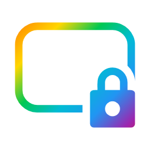

<p align="center"></p>

# OverlayLock

[](https://github.com/BootBlock/OverlayLock/actions/workflows/ci.yml)

[](https://github.com/BootBlock/OverlayLock/releases)

OverlayLock covers your monitors with a plain screen and hides the cursor until you type the
password you gave it on the command line. It's a small, fast Windows program with no runtime to
install, made to be started from a Stream Deck button, a shortcut or a script.

## What it is, and what it is not

OverlayLock is for the moments when you want the screen covered and the keyboard ignored for a
while: a child or a cat at the keyboard, a screen you don't want glanced at, or a message such as
"Back in five minutes". You type the password and the screen comes back.

It is not a security tool, and it doesn't replace Win+L. The password is part of the command line,
which any program running as the same user can read. Ctrl+Alt+Del and Win+L always work, because
Windows never passes them to an application, and from the Ctrl+Alt+Del screen anyone at the
keyboard can start Task Manager or sign out. Use the Windows lock screen when you need the
computer protected.

## Install

Download the zip for your processor (`x86_64` for most PCs, `aarch64` for ARM64) from the
[releases page](https://github.com/BootBlock/OverlayLock/releases), and unpack
`overlay-lock.exe` anywhere you like. Each release lists the SHA-256 sum of every zip in
`SHA256SUMS.txt`. The program needs Windows 10 version 1809 or later and nothing else: the
Visual C++ runtime is built in.

If you have a Rust toolchain, you can build and install it from source instead:

```powershell
cargo install --git https://github.com/BootBlock/OverlayLock
```

## Usage

This is the output of `overlay-lock --help`:

```text
OverlayLock 0.2.0, built on the 8th November 2026
Created by Joe Cox - https://bootblock.co.uk

OverlayLock covers the screen until a password is typed.

Usage: overlay-lock --password <TEXT> [OPTIONS]

Options:
  -p, --password <TEXT>       The password that unlocks. Required, not empty, case-sensitive.
      --monitors <all|cursor> Cover every monitor, or only the one under the cursor.
                              [default: all]
      --colour <COLOUR>       The background colour: #RGB, #RRGGBB or a CSS colour name.
                              Alias: --color. [default: black]
      --message <TEXT>        Text to show in the centre. \n starts a new line, \\ is a
                              backslash.
      --text-colour <COLOUR>  The message colour. Alias: --text-color. [default: #CCCCCC]
      --text-size <POINTS>    The message size in points, 4 to 400. [default: 28]
      --font <FAMILY>         The message font family.
                              [default: Segoe UI Variable Display, else Segoe UI]
      --block-keys            Swallow every key system-wide while locked.
      --block-mouse           Swallow every mouse event system-wide while locked.
      --timeout <DURATION>    Unlock after this long, such as 90s, 30m or 1h30m (1s to 7 days).
      --ignore-alt-f4         Alt+F4 does not unlock.
      --yield-on-ctrl-alt-del After the Ctrl+Alt+Del screen, step back so Task Manager gets
                              input. The password and the timeout still unlock.
  -h, --help                  Print this help and exit.
  -V, --version               Print the version and exit.

The --text-colour, --text-size and --font options need --message.

Exit codes:
  0  Unlocked (or help or version shown)
  1  A runtime failure
  2  A usage error
  3  Another instance is already locked
```

A colour is `#RGB` or `#RRGGBB` (the `#` is optional, and case doesn't matter) or any of the 148
named colours of CSS Color 4, such as `navy` or `rebeccapurple`. A duration is one or more whole
numbers with `h`, `m` and `s`, in that order, such as `45s`, `10m` or `1h30m`.

Started from a terminal, OverlayLock prints there and the terminal waits until the lock ends, so a
script can read the exit code (`$LASTEXITCODE` in PowerShell, `%ERRORLEVEL%` in Command Prompt).
Started from a shortcut or a Stream Deck button, it opens no console window, and help or an error
shows in a message box instead. (Before Windows 11 24H2, a console window may flash for a moment
at start-up.)

### Examples

To lock every monitor until you type `go`:

```powershell
overlay-lock --password go
```

To lock from a Stream Deck, add a **System > Open** action and set **App / File** to the full
path of `overlay-lock.exe` followed by its options, for example:

```text
"C:\Tools\overlay-lock.exe" --password go --timeout 1h
```

OverlayLock takes the focus from whatever window had it, so you can type the password straight
away. A Stream Deck **Text** action that types the password unlocks it too, even with
`--block-keys`.

To keep a child or a cat away from the keyboard and mouse, while making sure you can always get
back in from Ctrl+Alt+Del and that the lock ends by itself after half an hour:

```powershell
overlay-lock --password "Purr 42" --block-keys --block-mouse --yield-on-ctrl-alt-del --timeout 30m
```

To show a message on a dark blue screen:

```powershell
overlay-lock -p go --colour "#102030" --message "Locked\nBack in five minutes" --text-colour gold --text-size 48
```

## Behaviour

This section describes what OverlayLock does once it's running, so you know what to expect from
each option.

- **Monitors.** Each covered monitor gets its own window, sized to the whole monitor, taskbar
  included. If you change a resolution or plug in or remove a monitor while it's locked, the
  covered monitors follow the change. If the monitor you were typing on is removed, the keyboard
  focus moves to the overlay on another monitor, so you can carry on typing. With
  `--monitors cursor`, the monitor under the cursor at start stays covered, and the primary
  monitor takes its place if it's removed, along with the keyboard focus.
- **Focus.** At start, OverlayLock brings its window to the front and takes the keyboard focus,
  retrying for up to 2 seconds if another program holds on to it. After that it never takes the
  focus from another program again, so a window you open later (Task Manager, for example) stays
  usable. The one exception is a removed monitor: when the overlay you were typing on goes, the
  focus moves to one of OverlayLock's other overlays.
- **Cursor.** The cursor is hidden only over the covered monitors, and comes back as soon as the
  lock ends.
- **Typing the password.** The last characters you typed are compared with the password, so
  mistakes before it don't matter: `xxgo` unlocks a `go` lock. The comparison is case-sensitive,
  and every key counts, Backspace included.
- **`--block-keys`.** Every key is swallowed for the whole system, including the Windows key,
  Alt+Tab and Ctrl+Shift+Esc, and the password is read from the keys themselves. A dead key
  (such as `´` on some layouts) gives no character in this mode, so avoid accented characters
  that need one in a password you use with `--block-keys`.
- **`--block-mouse`.** Every mouse event is swallowed, movement included, until the lock ends.
- **Win+L.** While Windows is locked, both hooks let input through so the lock screen works. When
  you sign back in, the overlay is still there and the hooks swallow input again.
- **Alt+F4.** Alt+F4 unlocks unless you add `--ignore-alt-f4`, with or without `--block-keys`. A
  polite close request from another program, such as `taskkill` without `/f`, follows the same
  setting. Signing out or shutting down is never blocked.
- **Timeout.** `--timeout` ends the lock after the time you give, exactly as the password would.
- **One lock at a time.** A second OverlayLock started while one is locked exits at once with
  code `3` and shows nothing.
- **Messages.** Without `--message`, OverlayLock paints a plain colour and nothing else. With
  it, the text is centred, wraps at 80 % of the monitor width, and stays sharp at each monitor's
  display scale. If the `--font` family isn't installed, Windows picks a similar font, and that
  isn't an error.

## Recovery

If you forget the password, these are the ways out, from the gentlest:

1. **Wait for the timeout**, if you gave one. Adding `--timeout` to every lock you start is the
   simplest safety net.
2. **Press Alt+F4**, unless the lock has `--ignore-alt-f4`.
3. **Use Ctrl+Alt+Del.** Windows always shows this screen. With `--yield-on-ctrl-alt-del`, when
   you come back from it (by choosing Cancel or Task Manager), OverlayLock steps back: the hooks
   are removed and the overlay leaves the always-on-top layer, so Task Manager shows above it and
   takes your input. Choose **Task Manager** there and end `overlay-lock.exe`. Without `--yield-on-ctrl-alt-del`, a Task Manager started this way
   stays hidden behind the overlay and gets no input from `--block-keys` and `--block-mouse`, so
   choose **Sign out** instead; that ends the lock along with everything else in the session.

A User Account Control prompt uses the same secure screen as Ctrl+Alt+Del, but it does not make
OverlayLock step back: it looks at which Windows program owns the screen when it appears. When it
cannot tell, it steps back, so the lock is never harder to leave than intended. Win+L never makes
it step back.

## Build from source

You need Windows, the stable Rust toolchain (1.98 or later) and the Visual Studio C++ build tools.
For ARM64 builds you also need the Visual Studio component **MSVC ARM64 build tools**.

```powershell
cargo build --release
cargo build --release --target aarch64-pc-windows-msvc
```

The executable is `target\release\overlay-lock.exe` (or under `target\aarch64-pc-windows-msvc`
for ARM64). To build a copy you can run in place, for example from a Stream Deck button, run:

```powershell
cargo xtask dist
```

It builds for your processor and puts `overlay-lock.exe`, `LICENSE` and `README.md` in the
`!Distribution` folder. Each run replaces only those three files, so the path stays the same. End
any lock running from there first, because Windows cannot replace a running program. Add
`--zip <folder>` to write the zips a release publishes (both processors and `SHA256SUMS.txt`)
into that folder instead.

The icon is generated, not drawn: to render it again from the Segoe Fluent Icons glyph, run:

```powershell
cargo xtask icon
```

Before you send a change, run `cargo fmt --all --check`, `cargo clippy --workspace --all-targets
-- -D warnings` and `cargo test --workspace`. The tests in `tests/hooks.rs` take over the keyboard
and mouse for a few seconds, so they only run when you ask for them:
`cargo test --test hooks -- --ignored --test-threads=1`.

## Contributing

We're grateful for pull requests, but we're not actively accepting them at the moment. To report a
bug, ask for a feature or suggest a fix, [open an issue](https://github.com/BootBlock/OverlayLock/issues/new)
instead. See [CONTRIBUTING.md](CONTRIBUTING.md).

## Author

OverlayLock is written by Joe Cox ([bootblock.co.uk](https://bootblock.co.uk)).

## Licence

OverlayLock is released under the MIT licence. See [LICENSE](LICENSE).
